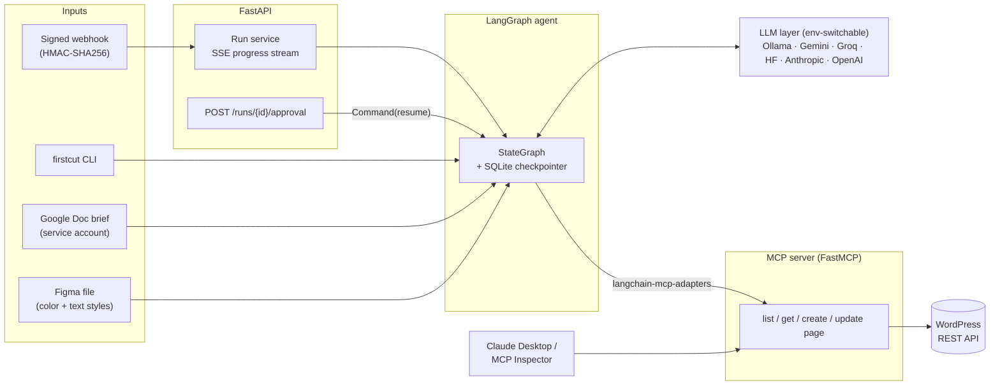
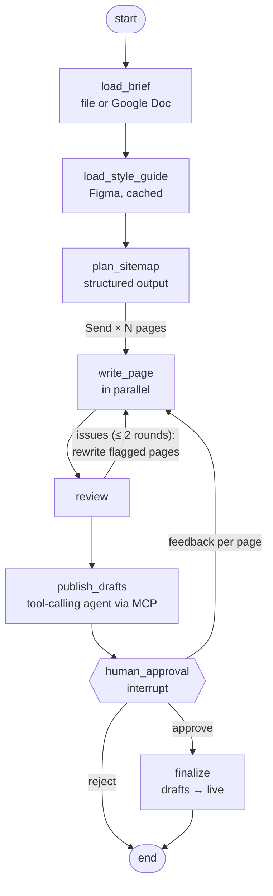

# First Cut

**Brief in, reviewed WordPress draft out.** First Cut is an agentic workflow for web agencies. It reads a client brief (markdown or a Google Doc) and the client's brand (Figma styles), plans a sitemap, writes every page, reviews its own copy, and saves the pages to WordPress as drafts through its own MCP server. Nothing goes live until a human approves.

**[Live demo on Hugging Face Spaces](https://huggingface.co/spaces/SirRedOfTheJohns/first-cut)** (preview mode, no WordPress) · **[Technical decisions](docs/DECISIONS.md)**

## The problem

Every agency project starts with the same hours of low-leverage work. Someone reads the brief, proposes a sitemap, drafts copy for each page, looks up the brand colors and fonts in Figma, and builds the pages in the CMS so the client has something to react to. First Cut does that first pass in about a minute, so the team starts from a structured draft instead of a blank page. People still decide what ships: the agent drafts, a human approves.

## How it works



The graph:



- **Parallel map/reduce:** the planner fans out one `write_page` task per page with `Send`, and the reviewer runs once all of them finish. Only the pages it flags are rewritten.
- **Tool calling where judgment helps, code where invariants matter:** a small `create_agent` loop decides which drafts to create or update. Code renders the HTML (the LLM never copies it into tool arguments), prevents duplicates, never touches live pages, and backfills anything the agent skipped.
- **MCP on both sides:** the agent reaches WordPress only through the project's own MCP server (stdio or streamable HTTP). Claude Desktop and MCP Inspector can use the same server.
- **Human in the loop:** `interrupt()` pauses the run, and the SQLite checkpointer keeps it across restarts. A reviewer approves (pages go live), sends feedback per page (only those pages are rewritten), or rejects.
- **Brand from Figma:** local color and text styles become a scoped stylesheet plus Google Fonts. Every block stays valid and editable in the WordPress editor.

## What it demonstrates

| Requirement | Where |
|---|---|
| Agentic workflows (LangGraph / LangChain) | `src/firstcut/graph/`: `StateGraph`, `Send`, reducers, `Command`, `interrupt`, `RetryPolicy`, runtime context |
| Tool use / function calling | `graph/publish.py` (agent over MCP tools), `structured.py` (structured output with validation feedback) |
| Streaming | SSE in `api/app.py`: node progress plus opt-in LLM tokens, resumable with `Last-Event-ID` |
| WordPress, Figma, Google Workspace | `integrations/`: REST + Application Passwords, Figma REST with caching, Docs API via service account |
| MCP servers | `mcp_server/` (FastMCP, tool annotations) and `mcp_client.py` (langchain-mcp-adapters) |
| REST APIs, webhooks, deployment | FastAPI with HMAC-signed, idempotent webhooks; Docker Compose; Hugging Face Space (ZeroGPU) |
| Production concerns | Persistent checkpoints, structured JSON logs with `run_id`, LangSmith tracing, gitleaks in CI, 60+ tests |

## Quick start

Requirements: Python 3.12+, [uv](https://docs.astral.sh/uv/), Docker, [Ollama](https://ollama.com) (or a cloud LLM key).

```bash
git clone https://github.com/SirRedofTheJohns/first-cut && cd first-cut
cp .env.example .env
uv sync

# Local model: Qwen3-8B pulled straight from the Hugging Face Hub
ollama pull hf.co/Qwen/Qwen3-8B-GGUF:Q8_0

# WordPress + MariaDB; a one-shot WP-CLI container installs it and prints an Application Password
docker compose up -d db wordpress wpcli
docker compose logs wpcli                  # copy WP_APP_PASSWORD into .env
docker compose up -d --build mcp api       # MCP server :8765, API :8000
```

### CLI

```bash
uv run firstcut run briefs/masa-bakery.md --preview          # generate only
uv run firstcut run briefs/masa-bakery.md                    # save drafts, approve in the terminal
uv run firstcut run "<Google Doc URL>" --figma "<Figma URL>"   # brief from Docs, brand from Figma
```

### API: webhook → streaming → approval

```bash
uv run python scripts/send_webhook.py briefs/masa-bakery.md      # signs, sends, follows the SSE stream
curl -N localhost:8000/runs/<run_id>/events?tokens=true          # raw SSE, with LLM tokens
curl -X POST localhost:8000/runs/<run_id>/approval -H 'Content-Type: application/json' \
     -d '{"approved": false, "feedback": {"contact": "Mention that pre-orders close Thursday at 6pm"}}'
curl -X POST localhost:8000/runs/<run_id>/approval -H 'Content-Type: application/json' \
     -d '{"approved": true}'
```

Webhook payload: `{"brief": "..."}` or `{"gdoc_url": "..."}`, plus an optional `"figma_url"`. Headers: `X-FirstCut-Timestamp`, `X-FirstCut-Signature: sha256=HMAC(secret, "{timestamp}.{body}")`, and an optional `X-FirstCut-Delivery` id for idempotency.

### MCP server

```bash
uv run python -m mcp_server                                       # stdio
npx @modelcontextprotocol/inspector uv run python -m mcp_server   # debug UI
```

For Claude Desktop, add the `mcpServers` entry from `mcp_server/claude_desktop_config.example.json` to `claude_desktop_config.json` (open it with **Settings → Developer → Edit Config**), set the repo path, and fully restart Claude. Credentials are read from the repo's `.env`, not from the Claude config. On Windows, use the full path to `uv.exe`, because GUI apps may not see your shell's `PATH`. Microsoft Store installs keep the file under `%LOCALAPPDATA%\Claude-Data\<package>\`, not `%APPDATA%\Claude\`.

## Switching LLM providers

The model layer is configured only through environment variables (`init_chat_model`). No code changes are needed.

| Provider | `LLM_PROVIDER` | Example `LLM_MODEL` | Key | Extra |
|---|---|---|---|---|
| Ollama (local, default) | `ollama` | `hf.co/Qwen/Qwen3-8B-GGUF:Q8_0` | none | none |
| Google Gemini | `google_genai` | `gemini-3.5-flash-lite` | `GOOGLE_API_KEY` | none |
| Groq | `groq` | `openai/gpt-oss-120b` | `GROQ_API_KEY` | none |
| Hugging Face Inference Providers | `huggingface` | `Qwen/Qwen3-8B` | `HF_TOKEN` | `uv sync --extra huggingface` |
| Anthropic | `anthropic` | `claude-sonnet-5-5` | `ANTHROPIC_API_KEY` | `uv sync --extra anthropic` |
| OpenAI | `openai` | `gpt-5-mini` | `OPENAI_API_KEY` | `uv sync --extra openai` |

Optional automatic fallback on provider errors (429, 5xx), for example for a free-tier demo:

```bash
LLM_PROVIDER=google_genai     LLM_MODEL=gemini-3.5-flash-lite
LLM_FALLBACK_PROVIDER=groq    LLM_FALLBACK_MODEL=openai/gpt-oss-120b
```

Provider quirks (Groq's JSON-schema mode, server-side validation errors, free-tier rate limits) are handled in one place, `structured.py` / `llm.py`, so the graph doesn't change between providers. The model choices were measured, not guessed: see [D011](docs/DECISIONS.md) for local models and [D027](docs/DECISIONS.md) for cloud models.

## Design decisions worth reading

[`docs/DECISIONS.md`](docs/DECISIONS.md) records 28 decisions with their alternatives. A few came from testing, not planning:

- Ollama compiles JSON-schema limits into a decoding grammar that **cuts text mid-word**, so length rules live in validators that send the error back to the model.
- For an 8B model, **field names steer output more than descriptions**: renaming `call_to_action` to `button_label` took first-try validity from 0/12 to 9/12.
- Shown its previous draft as JSON, the model **copied it back** (0/4 revisions applied). Rewriting from brief + request: 4/4. Human feedback is folded into the brief so the anti-hallucination rule doesn't block new facts.
- Gemini's free Flash models allow **20 requests/day**; Flash-Lite allows 500. One site takes ~8 calls, so this decided the demo model.
- LangGraph will refuse to deserialize unregistered types from checkpoints. Our state types are allow-listed, and the tests run in strict mode.

## Tests

```bash
uv run pytest                    # unit + graph + API + MCP tests, no network, fake LLM
uv run pytest -m integration     # against the local Docker WordPress
uv run python scripts/smoke_models.py   # compare local models on structured output and tool calling
```

The graph tests run the real MCP protocol over in-memory streams, so the agent's tools behave as in production. CI runs ruff, pytest and gitleaks.

## Limitations

- **One WordPress site per client.** Pages are matched by slug; running a second client against the same site reuses `/home`, and live pages are skipped rather than overwritten.
- **Brand application is a scoped stylesheet**, not the theme's Global Styles (`theme.json`). That would make it site-wide and editable in the Site Editor; it's the natural next step.
- **Live SSE events are kept in memory in one process.** Run state survives restarts (SQLite), but several API replicas would need Redis pub/sub and Postgres checkpoints.
- **Free tiers shape the demo.** Gemini Flash-Lite allows 500 requests/day; Groq allows 8K tokens/min (a fallback run takes minutes); ZeroGPU gives each visitor a few GPU minutes per day; Figma's free plan allows ~20 file reads per month (responses are cached for 24 h). Free-tier providers may use inputs for training, so use fictional briefs.
- **Copy quality is a first draft.** It's grounded in the brief and reviewed, but it's meant for an editor to polish, not to publish unread.

## Project layout

```
src/firstcut/        agent (graph/), LLM layer, structured output, rendering, integrations/, api/, CLI
mcp_server/          FastMCP WordPress server + Claude Desktop config example
app/                 Hugging Face Space (Gradio, ZeroGPU)
scripts/             WP bootstrap, webhook sender, model smoke test, Space deploy, Figma plugin
docs/                DECISIONS.md, DEMO_SCRIPT.md
briefs/              sample client briefs
```

## License

MIT
